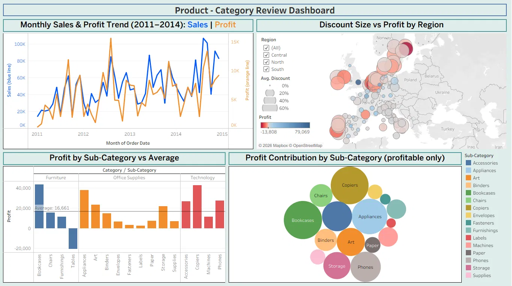

# Product & Category Review Dashboard: AmazingMart EU

A sales analysis built in **Tableau**, covering four years of European retail orders (January 2011 to December 2014). The dashboard shows how sales and profit have grown, which products earn or lose money, and how heavy discounting affects profit across European regions.

> The dashboard was built in Tableau and is shown here as a static image. Use the sections below to read each chart.

---

## Objective

1. Track how **sales and profit** have changed over time.
2. Find which **product sub-categories** drive profit and which lose money.
3. See whether **discounting** is hurting profit, and in which regions.

## Dataset

**File:** [AmazingMartEU2.xlsx](AmazingMartEU2.xlsx) (AmazingMart EU sample retail data)

| Sheet | Contents |
|---|---|
| `ListOfOrders` | 4,117 orders: order and ship dates, customer, city, state, country, region, segment, ship mode |
| `OrderBreakdown` | 8,047 order line items: product, category, sub-category, sales, profit, quantity, discount |
| `SalesTargets` | Monthly sales targets by category (not used in this dashboard) |

- **Period:** Jan 2011 to Dec 2014
- **Coverage:** 15 European countries, 792 customers
- **Data quality:** no missing values, no duplicate orders, and every line item matches an order
- **Currency:** the source file doesn't state a currency, so values are shown as plain numbers
- `ListOfOrders` and `OrderBreakdown` are joined on **Order ID**

## Headline numbers

| Metric | Value |
|---|---|
| Total sales | 2,348,482 |
| Total profit | 283,240 |
| Overall profit margin | 12.1% |
| Units sold | 30,354 |

---

## How to read each chart

### 1. Monthly Sales & Profit Trend (2011–2014)
**What it shows:** Monthly total sales (blue line, left axis) and profit (orange line, right axis).
**Why it's here:** To check whether the business is growing and whether profit keeps up with sales.
**How to read it:** The two axes use different scales (sales up to about 107K, profit up to about 16K), so compare the *shape* of the lines, not their heights.

**Insights**
- Sales grew every year: about 414K (2011), 549K (2012), 630K (2013) and 755K (2014).
- Profit also grew, from about 54K to 85K, but more slowly. Profit margin slipped from about **13.1% in 2011 to 11.3% in 2014**.
- Sales are seasonal. June, August, September, November and December are consistently the strongest months.
- The best sales month was **August 2014 (about 107K)**. The best profit month was **August 2012 (about 15.6K)**.

### 2. Discount Size vs Profit by Region (map)
**What it shows:** Each bubble is a state or region.
- **Bubble size** = average discount (see the Avg. Discount legend: 0% to 60%)
- **Bubble colour** = total profit (red = loss, blue = profit)

**Why it's here:** To show where discounting is concentrated and whether those places make money.

**Insights**
- Bubbles are largest and reddest in **Denmark, Sweden, Ireland, Portugal and the Netherlands**, where average discounts are about **48–51%**.
- Those same countries are the loss-makers: Netherlands (about -37.2K), Sweden (about -17.5K), Portugal (about -8.7K), Ireland (about -6.9K) and Denmark (about -3.6K).
- Markets with low discounts (UK about 7%, Germany about 5.5%, France about 7.7%, Spain about 3.4%) are the most profitable. The UK (about 90K), Germany (about 86K) and France (about 70K) lead.
- Stockholm shows the single largest regional loss (about -13.8K), while England is the most profitable region (about 79K).

### 3. Profit by Sub-Category vs Average (bar chart)
**What it shows:** Total profit for each of the 17 sub-categories, grouped by category (Furniture, Office Supplies, Technology). The horizontal line marks the **average profit per sub-category (16,661)**.
**Why it's here:** To separate the sub-categories that beat the average from those that lag behind, and to expose any that lose money.
**How to read it:** A bar that reaches above the line beats the average. A bar pointing **downward** is a loss.

**Insights**
- Seven sub-categories are above average: **Bookcases (about 43.7K), Copiers (about 42.8K), Appliances (about 37.9K), Phones (about 27.6K), Accessories (about 26.8K), Art (about 23.5K) and Storage (about 22.0K)**.
- **Tables is the only sub-category that loses money (about -20.7K).** It is the one downward bar in the chart.
- By category, Office Supplies has the best margin (about 15.2%), Technology is in the middle (about 12.3%), and Furniture is the weakest (about 7.8%), pulled down mainly by Tables.

### 4. Profit Contribution by Sub-Category (bubble chart)
**What it shows:** Bubble size = profit made by each sub-category. Colours match the Sub-Category legend on the right.
**Why it's here:** To show at a glance how each sub-category contributes to total profit.
**Important:** Only **profitable** sub-categories are shown, because a bubble can't represent a negative value. **Tables (about -20.7K) is therefore excluded**. See chart 3 for the full picture.

**Insights**
- **Bookcases, Copiers and Appliances** are the biggest profit contributors, followed by Phones and Accessories.
- Small bubbles (Fasteners, Labels, Envelopes, Supplies, Paper) are low in sales but have healthy margins of roughly 18–21%.

---

## Key findings

1. **The business is growing**, with sales up about 82% from 2011 to 2014, but profit margin is slowly shrinking.
2. **Heavy discounting is the main driver of losses.** In the underlying data, line items discounted 30% or more lose money overall (about -144K), and the 50% discount level alone loses about 86K across 982 line items.
3. **Five countries lose money**, all with discounts around 50% (Denmark, Sweden, Ireland, Portugal, Netherlands).
4. **Tables** is the one sub-category with a loss, which is why Furniture has the lowest margin.
5. About **21.5% of all line items are loss-making** (about -161K in total).

## Suggested actions

- Review or cap discounts above 30%, especially in Scandinavia, the Netherlands, Ireland and Portugal.
- Review pricing, cost and discounting on **Tables**.
- Keep promoting the strong performers (Bookcases, Copiers, Appliances, Phones) in markets where discounts are already low.

---

## Filters in the Tableau workbook

The workbook includes **Region** and **Category** filters. They aren't active in the static image above.

## Tools used

- **Tableau Desktop**: dashboard design
- **Microsoft Excel**: source data

## Repository contents

- `README.md`: this file
- `amazingmart-eu-sales-dashboard.webp`: dashboard image
- `AmazingMartEU2.xlsx`: source data
- `Product Category Review Dashboard.twb`: Tableau workbook

## Open the Tableau workbook yourself

1. Download both `AmazingMartEU2.xlsx` and `Product Category Review Dashboard.twb` into the same folder.
2. Open the `.twb` file in Tableau Desktop (or the free Tableau Public desktop app).
3. If Tableau can't find the data, click **Edit Data Source** and point it to your downloaded `AmazingMartEU2.xlsx`.

## Author

[Your Name] · [GitHub](https://github.com/AyzusD)
