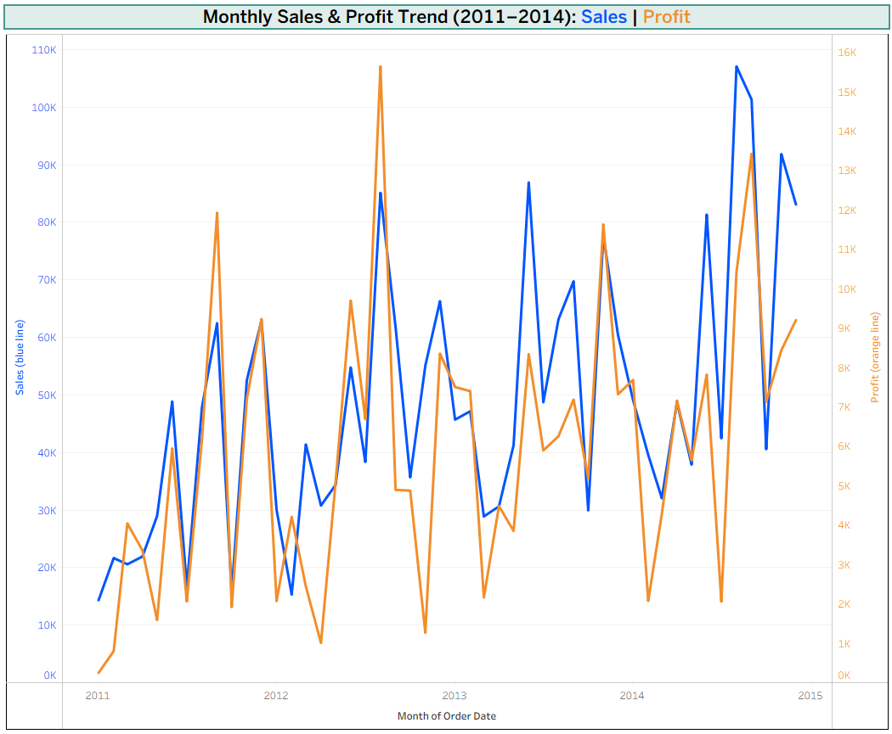
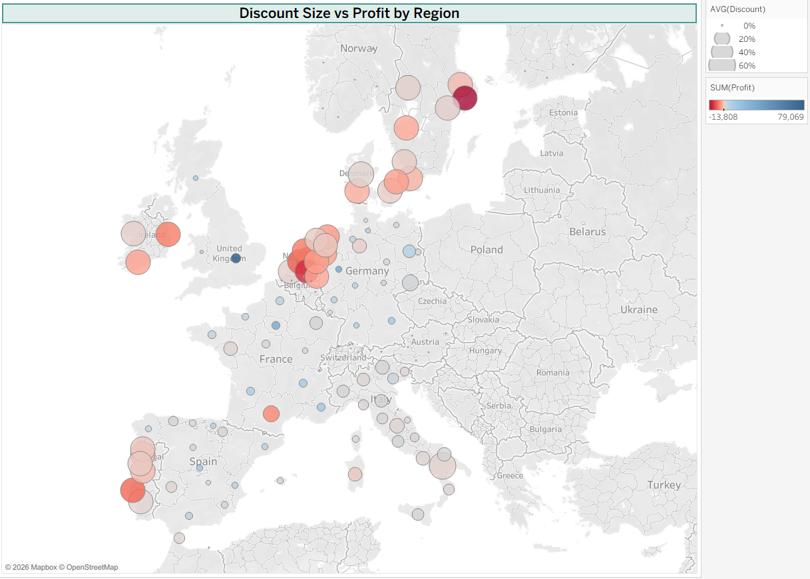
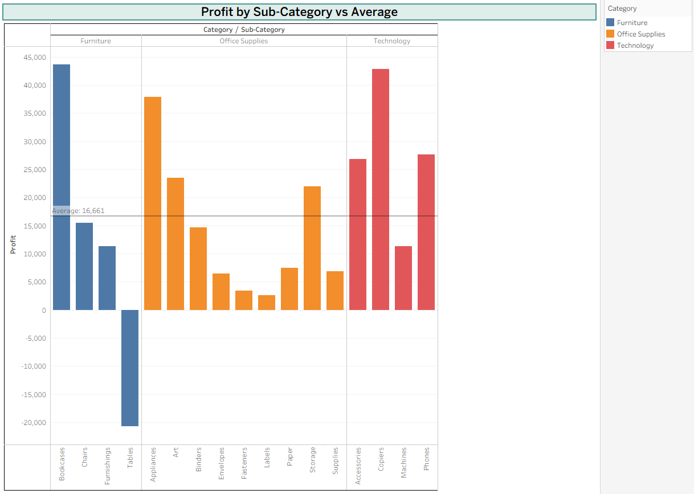
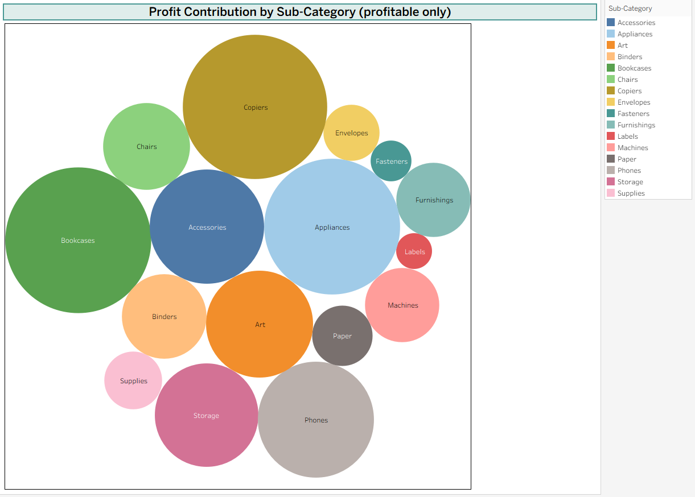

# Product & Category Review Dashboard: AmazingMart EU

A sales analysis built in **Tableau**, covering four years of European retail orders (January 2011 to December 2014). The dashboard shows how sales and profit have grown, which products earn or lose money, and how heavy discounting affects profit across European regions.

> The dashboard was built in Tableau and is shown here as a static image. Each of the four charts is explained separately below, with a full-size image.

## Contents

1. [Objective](#objective)
2. [Dataset](#dataset)
3. [Headline numbers](#headline-numbers)
4. [Chart 1: Monthly Sales & Profit Trend](#chart-1-monthly-sales--profit-trend)
5. [Chart 2: Discount Size vs Profit by Region](#chart-2-discount-size-vs-profit-by-region)
6. [Chart 3: Profit by Sub-Category vs Average](#chart-3-profit-by-sub-category-vs-average)
7. [Chart 4: Profit Contribution by Sub-Category](#chart-4-profit-contribution-by-sub-category)
8. [Key findings](#key-findings)
9. [Suggested actions](#suggested-actions)
10. [Tools used and repository contents](#tools-used)

---

## Objective

1. Track how **sales and profit** have changed over time.
2. Find which **product sub-categories** drive profit and which lose money.
3. See whether **discounting** is hurting profit, and in which regions.

## Dataset

**File:** [AmazingMartEU2.xlsx](AmazingMartEU2.xlsx) (AmazingMart EU sample retail data)

| Sheet | Contents |
|---|---|
| `ListOfOrders` | 4,117 orders: order and ship dates, customer, city, state, country, region, segment, ship mode |
| `OrderBreakdown` | 8,047 order line items: product, category, sub-category, sales, profit, quantity, discount |
| `SalesTargets` | Monthly sales targets by category (not used in this dashboard) |

- **Period:** Jan 2011 to Dec 2014
- **Coverage:** 15 European countries, 792 customers
- **Data quality:** no missing values, no duplicate orders, and every line item matches an order
- **Currency:** the source file doesn't state a currency, so values are shown as plain numbers
- `ListOfOrders` and `OrderBreakdown` are joined on **Order ID**

## Headline numbers

| Metric | Value |
|---|---|
| Total sales | 2,348,482 |
| Total profit | 283,240 |
| Overall profit margin | 12.1% |
| Units sold | 30,354 |

---

## Chart 1: Monthly Sales & Profit Trend

**Question it answers:** Is the business growing, and is profit keeping pace with sales?

**What it shows:** Total sales (blue line, left axis) and total profit (orange line, right axis) for every month from January 2011 to December 2014.

**How to read it**
- The two axes use **different scales**: sales go up to about 107K, profit only to about 16K. Compare the *shape* of the two lines, not their heights.
- When the orange line rises with the blue line, extra sales are turning into extra profit. When they move apart, sales are growing without the same profit gain.
- The "2015" label on the horizontal axis is only the end of the axis. The data stops in December 2014.

**Detailed insights**

| Year | Sales | Profit | Profit margin |
|---|---|---|---|
| 2011 | 414,348 | 54,487 | 13.1% |
| 2012 | 548,880 | 66,223 | 12.1% |
| 2013 | 630,224 | 77,200 | 12.2% |
| 2014 | 755,030 | 85,330 | 11.3% |

- **Steady growth:** sales rose every year, up about **82%** from 2011 to 2014. Profit rose about **57%** over the same period.
- **Margin is shrinking:** profit grew more slowly than sales, so margin fell from 13.1% to 11.3%. Selling more didn't mean earning proportionally more.
- **Strong seasonality:** June, August, September, November and December bring in roughly double the sales of the other months. Across the four years, August alone adds up to about 303K, against about 122K for October.
- **Peaks:** the best sales month was **August 2014 (about 107K)**. The best profit month was **August 2012 (about 15.6K)**, which is higher than any month since, even though sales were lower.
- **Volatility:** both lines swing sharply from month to month, so a single month says little. Look at the yearly pattern.

**Takeaway:** growth is real, but profit isn't keeping up with sales. That points to costs or discounts, which the next charts investigate.

---

## Chart 2: Discount Size vs Profit by Region

**Question it answers:** Where is discounting heaviest, and do those places make or lose money?

**What it shows:** A map of Europe. Each bubble is a state or region.
- **Bubble size** = average discount given (small = near 0%, large = up to about 60%)
- **Bubble colour** = total profit (**red = loss**, light = around break-even, **blue = profit**)

**How to read it:** Look for **large red bubbles**: those are regions with heavy discounts and losses. Small blue bubbles are regions with low discounts and good profit.

**Detailed insights**

| Country | Average discount | Total profit |
|---|---|---|
| Denmark | 50.8% | -3,608 |
| Sweden | 50.8% | -17,524 |
| Ireland | 50.3% | -6,886 |
| Portugal | 50.0% | -8,704 |
| Netherlands | 48.1% | -37,188 |
| Italy | 12.5% | 15,802 |
| France | 7.7% | 70,067 |
| United Kingdom | 7.0% | 90,382 |
| Germany | 5.5% | 86,279 |
| Spain | 3.4% | 47,067 |
| Austria, Belgium, Finland, Norway, Switzerland | 0% | all profitable |

- **A clear split:** five countries discount at about **48–51%** and all five lose money. Every other country discounts **under 13%** and is profitable.
- **Biggest problem market:** the Netherlands loses about **37.2K**, the largest country loss.
- **Biggest single region loss:** Stockholm, at about **-13.8K** (the dark red bubble in Sweden).
- **Best region:** England, with about **79K** profit on a low average discount (the dark blue dot in the UK).
- **Strongest markets** by profit are the UK (about 90K), Germany (about 86K) and France (about 70K), all with discounts below 8%.

**Takeaway:** discount level lines up closely with profit and loss across countries, and the countries discounting around 50% are the ones losing money.

---

## Chart 3: Profit by Sub-Category vs Average

**Question it answers:** Which sub-categories earn more than average, and which fall short or lose money?

**What it shows:** Total profit for all 17 sub-categories, grouped by category (Furniture, Office Supplies, Technology). The horizontal line is the **average profit per sub-category: 16,661**.

**How to read it:** A bar that reaches above the line beats the average. A bar below it lags. A bar pointing **downward** below zero is a **loss**.

**Detailed insights**

| Sub-category | Profit | Profit margin | Above average? |
|---|---|---|---|
| Bookcases | 43,655 | 14.8% | Yes |
| Copiers | 42,775 | 14.7% | Yes |
| Appliances | 37,906 | 18.1% | Yes |
| Phones | 27,631 | 9.8% | Yes |
| Accessories | 26,830 | 20.4% | Yes |
| Art | 23,491 | 18.5% | Yes |
| Storage | 21,995 | 8.1% | Yes |
| Chairs | 15,489 | 8.3% | Just below |
| Binders | 14,703 | 18.6% | Just below |
| Furnishings | 11,321 | 16.6% | No |
| Machines | 11,318 | 6.2% | No |
| Paper | 7,485 | 20.8% | No |
| Supplies | 6,853 | 17.7% | No |
| Envelopes | 6,463 | 20.7% | No |
| Fasteners | 3,420 | 21.1% | No |
| Labels | 2,636 | 20.6% | No |
| **Tables** | **-20,731** | **-23.2%** | **Loss** |

- **Seven of 17** sub-categories are above average. Together they earn most of the profit.
- **Tables is the only loss-maker.** It lost about **20.7K** on about 89K of sales, a **-23% margin**. It's the single downward bar in the chart.
- **By category:** Office Supplies has the best margin (about 15.2%), Technology is in the middle (about 12.3%), and Furniture is the weakest (about 7.8%). Furniture is dragged down mainly by Tables, even though Bookcases is the single best sub-category.
- **High profit isn't always high margin.** Phones, Storage and Machines make good money in total but have low margins (about 6–10%), while small items such as Fasteners, Labels, Envelopes and Paper earn margins above 20% on small volumes.
- **Note on the line label:** the "Average: 16,661" label overlaps the first bar. This is only cosmetic.

**Takeaway:** most sub-categories are healthy, but Tables is a clear problem and several low-margin sub-categories deserve a pricing review.

---

## Chart 4: Profit Contribution by Sub-Category

**Question it answers:** How much does each sub-category contribute to total profit?

**What it shows:** A bubble for each profitable sub-category. **Bigger bubble = more profit.** Colours match the Sub-Category legend on the right.

**How to read it:** Compare bubble sizes to see each sub-category's share of profit at a glance. The bar chart gives exact values, and this chart shows proportions.

**Important:** only **profitable** sub-categories are shown (16 of 17), because a bubble can't represent a negative value. **Tables (about -20.7K) is therefore excluded.** See Chart 3 for the full picture.

**Detailed insights**
- **Bookcases, Copiers and Appliances** are the three largest bubbles, together contributing about **124K** profit, which is more than 40% of the total shown.
- **Phones, Accessories, Art and Storage** form the next tier, each contributing between about 22K and 28K.
- The small bubbles (Fasteners, Labels, Envelopes, Supplies, Paper) contribute little in absolute terms, even though their margins are high.
- Profit is **concentrated in a handful of sub-categories**, so a problem in any of the top three would noticeably affect overall profit.

**Takeaway:** protect and grow the big three, and treat the small high-margin sub-categories as opportunities to scale.

---

## Key findings

1. **The business is growing**, with sales up about 82% from 2011 to 2014, but profit margin is slowly shrinking (13.1% to 11.3%).
2. **Heavy discounting is the main driver of losses.** In the underlying data, line items discounted 30% or more lose money overall (about -144K), and the 50% discount level alone loses about 86K across 982 line items.
3. **Five countries lose money**, all with average discounts around 50% (Denmark, Sweden, Ireland, Portugal, Netherlands).
4. **Tables** is the one sub-category with a loss, which is why Furniture has the lowest margin.
5. About **21.5% of all line items are loss-making** (about -161K in total).
6. **Profit is concentrated** in a few sub-categories: Bookcases, Copiers and Appliances.

## Suggested actions

- Review or cap discounts above 30%, especially in Scandinavia, the Netherlands, Ireland and Portugal.
- Review pricing, cost and discounting on **Tables**.
- Keep promoting the strong performers (Bookcases, Copiers, Appliances, Phones) in markets where discounts are already low.
- Look into the low-margin sub-categories (Machines, Storage, Phones) to see whether pricing can improve.

---

## Tools used

- **Tableau Desktop**: dashboard design
- **Microsoft Excel**: source data

## Repository contents

- `README.md`: this file
- `amazingmart-eu-sales-dashboard.webp`: full dashboard image
- `images/`: the four individual chart images
- `AmazingMartEU2.xlsx`: source data
- `Product Category Review Dashboard.twb`: Tableau workbook

## Open the Tableau workbook yourself

The workbook includes **Region** and **Category** filters, which aren't active in the static images above.

1. Download both `AmazingMartEU2.xlsx` and `Product Category Review Dashboard.twb` into the same folder.
2. Open the `.twb` file in Tableau Desktop (or the free Tableau Public desktop app).
3. If Tableau can't find the data, click **Edit Data Source** and point it to your downloaded `AmazingMartEU2.xlsx`.

## Author

[Your Name] · [GitHub](https://github.com/AyzusD)
